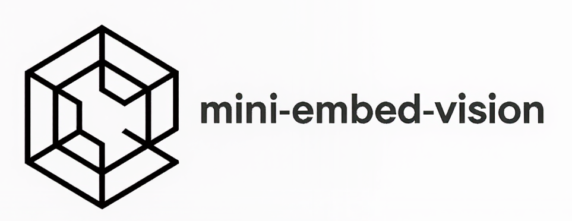

---
language:
- zh
license: apache-2.0
---

<div align="center">



# mini-embed-vision

轻量级中文图文统一嵌入模型（Multimodal Embedding Model for Chinese）

[中文](./README.md) | [English](./README_en.md)

</div>

## 📌 简介

* **mini-embed-vision** 是一个轻量级的中文多模态嵌入模型，旨在为个人开发者提供可复现、低成本、高性能的图文联合嵌入方案。
* 本项目在 **冻结文本编码器** 的前提下，基于对比学习（Contrastive Learning）框架，通过可训练的投影层对齐图像与文本的嵌入空间，在显著降低训练成本的同时保持良好的跨模态对齐能力。
* **基座模型**：
  - 文本编码器：`BAAI/bge-base-zh-v1.5`
  - 视觉编码器：`openai/clip-vit-base-patch32`
* **适用场景**：中文图文检索、多模态搜索、内容理解、边缘设备部署等资源受限环境。

---

## 📦 项目结构

* mini-embed-vision/

  ├── Model.py # 多模态模型结构定义
  ├── train.py # 训练脚本
  ├── data.py # 数据加载与预处理（基于 COCO128，支持扩展）
  ├── example/ # 使用示例
  │ ├── test_embed_image.py # 图像嵌入示例
  │ └── test_image_text_ser.py # 图文检索示例
  ├── requirements.txt # 依赖库
  └── README.md # 本文档

  > ✅ 兼容 `transformers`、`peft`、`datasets` 等主流 Hugging Face 生态库。

---

## 🚀 快速开始

### 0. 环境搭建

#### 0.1 克隆代码
```bash
git clone https://github.com/SyJarvis/mini-embed-vision.git
cd mini-embed-vision
```

#### 0.2 安装依赖

```
pip install -r requirements.txt
```


### 1. 使用预训练模型

#### 1.1 下载模型（推荐使用国内镜像加速）

> 💡 由于 Hugging Face 官方服务器访问受限，建议通过 HF-Mirror 镜像下载。 

方法一：使用 huggingface-cli + 镜像

```bash
export HF_ENDPOINT=https://hf-mirror.com
huggingface-cli download --resume-download syjarvis/mini-embed-vision-v1.0 --local-dir ./mini-embed-vision-v1.0
```

方法二：使用modelscope

```bash
modelscope download --model shangye/mini-embed-vision-v1.0
```

#### 1.2 运行示例

* 图像嵌入提取

  ```bash
  python example/test_embed_image.py
  ```

* 图文检索示例

  ```
  python example/test_image_text_ser.py
  ```


### 2. 推理示例（代码）

#### 图像嵌入提取

```python
from PIL import Image
from transformers import AutoTokenizer, AutoImageProcessor, AutoModel
import requests
import torch

model_dir = "./mini-embed-vision-v1.0"

tokenizer = AutoTokenizer.from_pretrained(model_dir)
image_processor = AutoImageProcessor.from_pretrained(model_dir)
model = AutoModel.from_pretrained(model_dir, trust_remote_code=True).to("cuda")

url = 'http://images.cocodataset.org/val2017/000000039769.jpg'
image = Image.open(requests.get(url, stream=True).raw).convert("RGB")
inputs = image_processor(image, return_tensors="pt").to("cuda")

with torch.no_grad():
    emb = model.encode_image(inputs["pixel_values"])  # shape: [1, 768]

print("✅ 图像嵌入形状:", emb.shape)
print("✅ 嵌入范数（应为 1.0）:", torch.norm(emb, dim=-1).item())
```

#### 多模态图文检索

```python
from PIL import Image
from transformers import AutoTokenizer, AutoImageProcessor, AutoModel
import requests
import torch

model_dir = "./mini-embed-vision-v1.0"
model = AutoModel.from_pretrained(model_dir, trust_remote_code=True).to("cuda")
tokenizer = AutoTokenizer.from_pretrained(model_dir)
image_processor = AutoImageProcessor.from_pretrained(model_dir)

# 图像
url = "http://images.cocodataset.org/val2017/000000039769.jpg"
image = Image.open(requests.get(url, stream=True).raw).convert("RGB")
image_inputs = image_processor(image, return_tensors="pt").to("cuda")

# 文本查询
queries = [
    "两只猫坐在沙发上",
    "一只狗在草地上奔跑",
    "可爱的猫咪",
    "海洋中的鲸鱼",
    "室内宠物"
]

# 编码图像
with torch.no_grad():
    image_embedding = model.get_image_features(**image_inputs)  # [1, 768]

# 编码文本
text_embeddings = []
for text in queries:
    encoded = tokenizer(text, return_tensors="pt", padding=True, truncation=True, max_length=512).to("cuda")
    with torch.no_grad():
        emb = model.get_text_features(**encoded)  # [1, 768]
    text_embeddings.append(emb)

text_embeddings = torch.cat(text_embeddings, dim=0)  # [N, 768]

# 计算相似度（已 L2 归一化，点积 = 余弦相似度）
similarities = torch.matmul(image_embedding, text_embeddings.T).squeeze(0)

# 排序输出
print("\n🔍 图文检索结果（按相关性排序）:")
results = sorted(zip(queries, similarities.tolist()), key=lambda x: x[1], reverse=True)
for i, (query, score) in enumerate(results, 1):
    print(f"{i}. {query} → 相似度: {score:.4f}")
```


### 3. 从头训练模型

🛠️ 训练脚本位于 train.py， 现提供了COCO128 数据集。欢迎提交 PR 扩展更多数据集或训练策略。 

训练命令

```bash
python train.py
```


## **📝 更新日志**

<details close>
    <summary><b>2025-10-20</b></summary>
    * 实现了基础的多模态嵌入模型
    * 支持图像/文本嵌入提取与多模态检索
    * 发布V1.0预训练模型到Hugging Face Hub
</details>


## 📌 Acknowledge

> [!NOTE]
> 如果觉得`miniembed-vision`对您有所帮助，可以在 GitHub 上加一个⭐<br/>
> 因水平有限难免疏漏，欢迎在Issues交流指正或提交PR改进项目<br/>


## **📜 许可证**

本项目采用 [Apache License 2.0](LICENSE) 开源协议。


## 🙏 致谢

* [BAAI/bge-base-zh-v1.5](https://huggingface.co/BAAI/bge-base-zh-v1.5)
* [OpenAI CLIP](https://github.com/openai/CLIP)
* [contrastors](https://github.com/nomic-ai/contrastors)